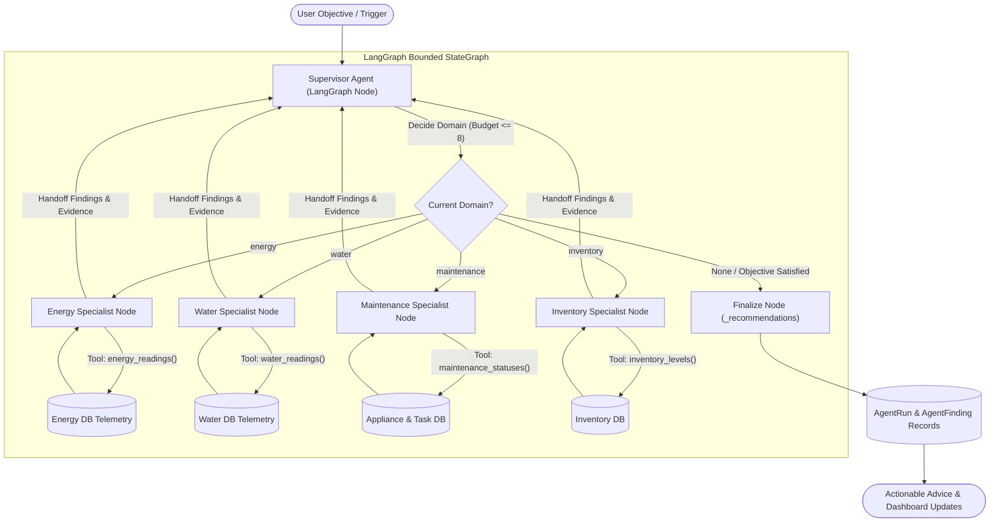
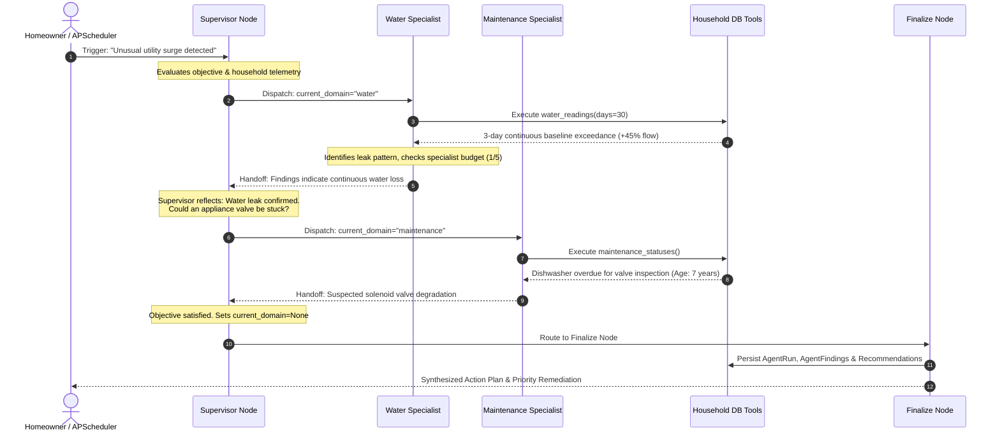
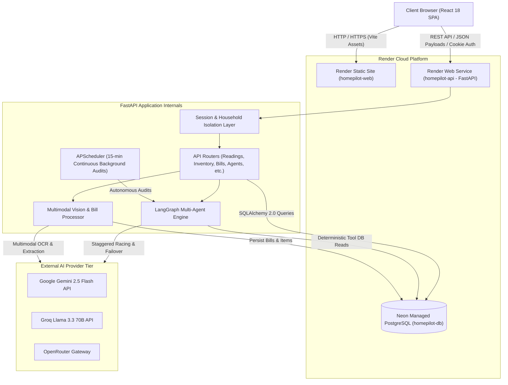
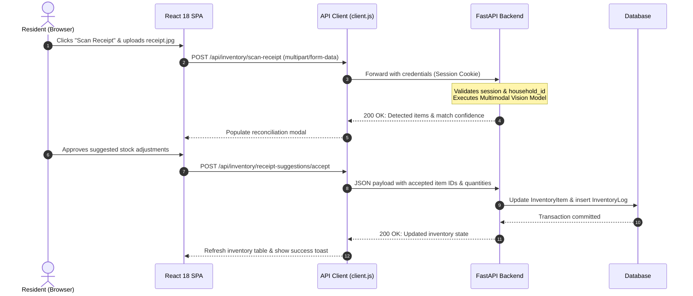
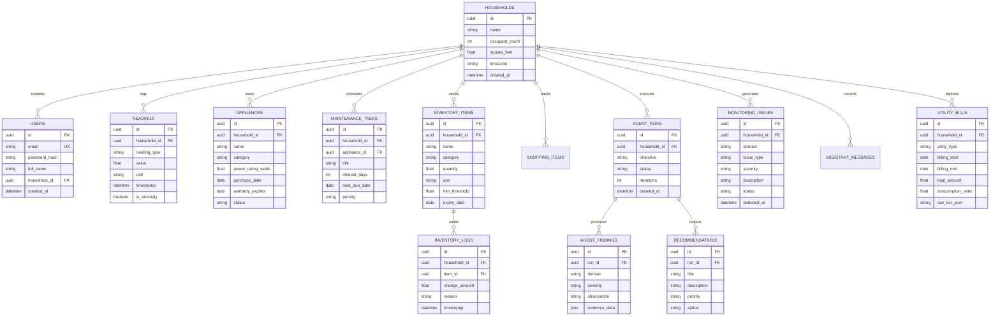
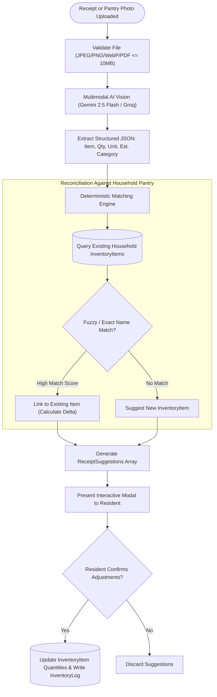
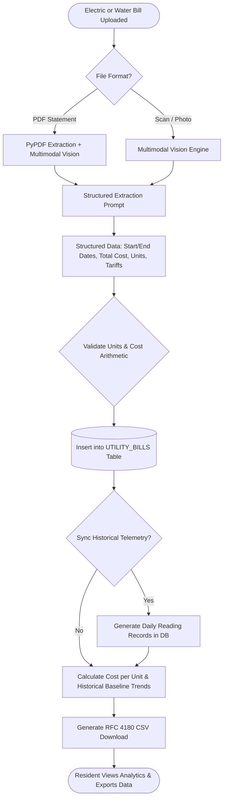
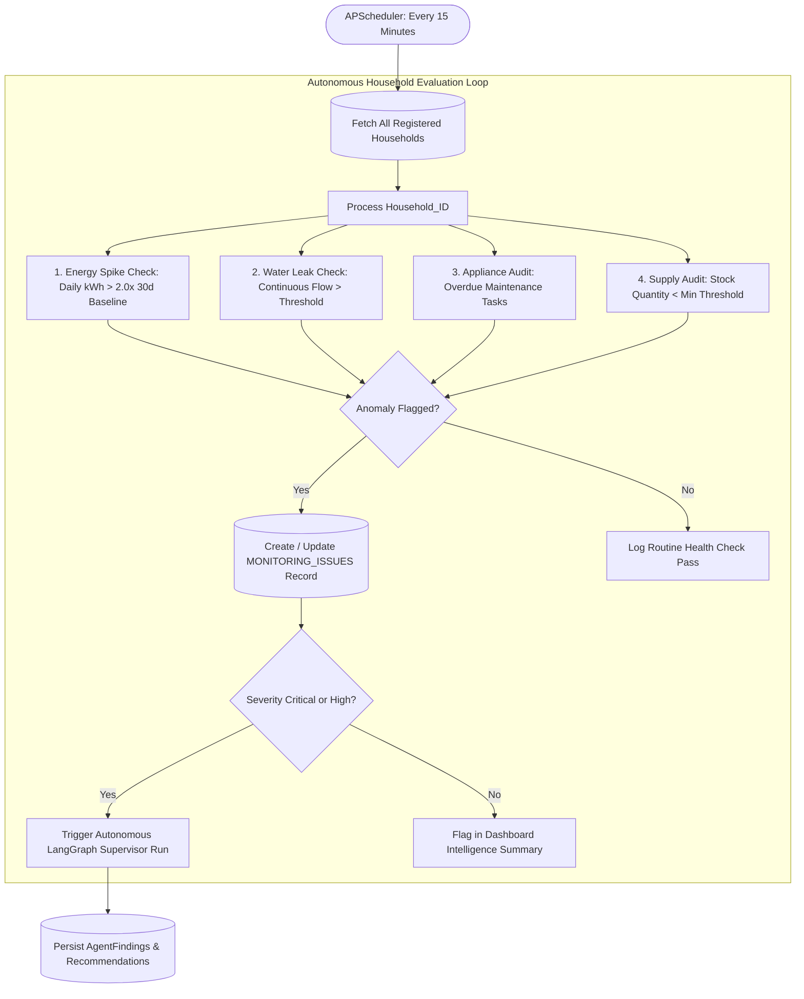
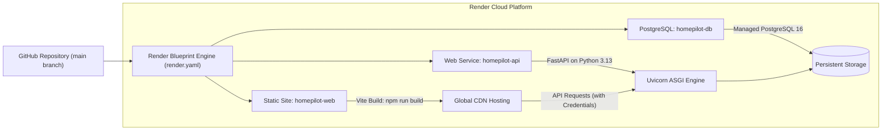

# HomePilot AI — Complete Project Documentation

---

## 1. Project Overview

HomePilot AI is an autonomous, multi-agent artificial intelligence system engineered for holistic household resource management and operations. Developed as an applied capstone project within the IBM SkillsBuild Agentic AI framework, HomePilot AI targets key United Nations Sustainable Development Goals (SDGs)—specifically Affordable and Clean Energy (SDG 7), Sustainable Cities and Communities (SDG 11), Responsible Consumption and Production (SDG 12), and Climate Action (SDG 13).

To understand HomePilot AI in everyday terms, consider modern domestic living: a modern household operates like a complex small enterprise. Electricity runs cooling, heating, cooking, and appliances; water flows through plumbing networks, water heaters, and irrigation lines; appliances degrade over continuous operational cycles; and consumable goods in pantries and utility closets cycle through procurement and depletion. In the typical household, these domains are completely siloed. A resident receives an electric utility bill weeks after an inefficient air conditioner runs continuously; a toilet flapper valve leaks quietly for forty-eight hours until water damage appears or a triple-digit water bill arrives; grocery supplies run out unpredictably, prompting urgent trips and food spoilage; and appliance warranties lapse without routine filter replacements.

Existing "smart home" software generally consists of isolated dashboards or remote switches. They act as passive displays requiring the homeowner to interpret charts, spot anomalies, remember maintenance schedules, and cross-reference utility tariffs. Conversely, generic conversational AI chatbots lack deterministic access to historical household telemetry, hallucinate calculations, and cannot safely verify physical constraints.

HomePilot AI introduces an **agentic operational paradigm**. Instead of asking the homeowner to monitor raw meter charts or rely on unverified chatbot text, HomePilot AI deploys a coordinated team of specialized AI agents supervised by a central coordinator. These agents continuously audit household telemetry, detect subtle baseline drifts, execute deterministic mathematical diagnostics, cross-examine physical symptoms across domains, digitize physical bills and inventory receipts via computer vision, and deliver verified, actionable interventions before minor anomalies escalate into costly domestic emergencies.

---

## 2. Problem Statement and Motivation

Modern residential management suffers from three systemic vulnerabilities:

1. **Fragmented and Delayed Telemetry**: Consumption data for electricity and water is typically collected through disparate utility portals, legacy paper bills, or siloed IoT apps. Residents inspect usage retrospectively—often 30 to 45 days after consumption occurred—preventing proactive conservation or immediate leak containment.
2. **Cognitive Burden and Alert Fatigue**: Homeowners do not have the time or expertise to compute rolling standard deviations, baseline kilowatt-hour drifts, or continuous minimum flow thresholds. When consumer IoT systems do produce notifications, they are often noisy threshold alerts lacking context, root-cause analysis, or cross-domain correlation.
3. **The Hallucination and Safety Gap in General LLMs**: Pure large language model interfaces are fundamentally unsuited for domestic resource auditing when operated without guardrails. LLMs are probabilistic token predictors; when asked whether a household has a water leak or an electric overload, an unconstrained LLM can invent numerical readings, miscalculate cost baselines, and propose unsafe physical actions.

HomePilot AI was created to solve these challenges through a unified, sovereign platform. By coupling LangGraph-based agentic workflows with deterministic Python computational tools, strictly isolated multi-tenant databases, and multimodal vision engines, HomePilot AI bridges the gap between raw physical telemetry and verified, explainable household intelligence.

---

## 3. HomePilot AI from a User's Perspective

The user journey through HomePilot AI is designed to be frictionless, protective of privacy, and operationally intuitive:

### Onboarding and Household Initialization
A new resident registers via an authenticated session. Upon initial login, the platform provisions an isolated household entity. The user enters fundamental baseline parameters: household name, occupant count, property square footage, and geographic or climatic characteristics. The user can also populate realistic demonstration datasets with a single click to explore full operational capabilities immediately.

### Unified Command Dashboard
The central dashboard provides an executive overview of domestic operations:
- **Operational Health Score**: A composite rating reflecting resource efficiency, unresolved alerts, and pending maintenance.
- **Telemetry Quick-Glance**: Real-time electricity consumption (kWh/day) and water flow (L/day) paired with 30-day baseline comparisons.
- **Active Issues and Open Recommendations**: Prioritized findings generated by background monitoring routines or agent investigations, tagged with urgency tiers (Critical, High, Medium, Low).
- **Consumable Pantry Alerts**: Immediate visibility into items that have fallen below safety reorder levels.

### Specialist Operational Views
Users can drill down into four dedicated specialist consoles:
- **Energy Console**: Visualizes daily electricity trends against rolling 30-day baselines, highlights peak consumption anomalies, breaks down appliance power ratings, and accepts manual meter logs or batch CSV telemetry imports.
- **Water Console**: Visualizes daily water usage, tracks leak signature heuristics (including continuous flow patterns and baseline exceedance), and logs meter intervals.
- **Maintenance Console**: Catalogs household appliances, tracks purchase dates, warranty expirations, and power ratings, and manages recurring maintenance task checklists with due-date tracking.
- **Inventory Console**: Displays household consumables grouped by room or category (Pantry, Kitchen, Laundry, Bathroom), tracks current stock against safety thresholds, and maintains an automated household shopping list.

### Multimodal Vision Scanning
Residents can point their smartphone or upload photos/documents directly into the platform:
- **Receipt and Pantry Scanner**: Residents upload receipts or pantry photos. The vision engine detects consumable items, infers categories, measures quantities, calculates confidence ratings, and presents suggestions for one-click pantry stock adjustments.
- **Utility Bill Digitization**: Residents upload PDF or image electric/water bills. The engine extracts billing periods, total due, consumption units, tariff surcharges, and breakdown line items, synchronizing them directly into historical telemetry and offering RFC 4180 CSV export.

### Grounded Operational Assistant
A persistent, conversational assistant allows homeowners to query their household status in natural language (e.g., "Why was our water consumption high on Thursday?" or "Check if any appliances need maintenance this weekend"). The assistant queries deterministic household tools in real time and can trigger a full LangGraph supervisor investigation on demand.

---

## 4. Complete Feature Overview

| Capability | Module | Core Functionality | Primary Tech Component |
| :--- | :--- | :--- | :--- |
| **Multi-Agent Supervisor** | `agent_graph.py` | Dynamically evaluates household goals, dispatches domain specialists, and synthesizes evidence. | LangGraph StateGraph, Multi-Provider LLM |
| **Deterministic Toolsets** | `agent_service.py` | Computes statistical metrics, baseline standard deviations, and leak heuristics in pure Python. | SQLAlchemy 2.0, Python Math |
| **Continuous Monitoring** | `monitoring_service.py` | Autonomous 15-minute scheduled audits for energy spikes, continuous leaks, and inventory shortages. | APScheduler, FastAPI Lifecycle |
| **Vision Inventory OCR** | `vision_service.py` | Multimodal receipt and pantry image processing with fuzzy inventory matching and audit logging. | Gemini / Groq Vision / OpenRouter |
| **Bill Digitization** | `bill_service.py` | Extracts structured utility data from PDFs and images; exports RFC 4180 CSV; updates telemetry. | PyPDF, Multimodal Vision, CSV Generator |
| **Grounded Assistant** | `assistant_service.py` | Natural language operational chat grounded in live database queries with trace provenance. | Multi-Provider Racing LLM |
| **Household Multi-Tenancy**| `auth.py`, `models.py` | Session-cookie authenticated isolation ensuring data queries strictly filter by `household_id`. | Starlette Session, SQLAlchemy ORM |
| **Telemetry Ingestion** | `readings.py` | Manual reading logging, historical timeseries queries, and batch CSV imports for electricity and water. | FastAPI, Pydantic v2 |
| **Appliance & Task Tracking**| `appliances.py`, `tasks.py` | Appliance lifecycle, power ratings, warranty alerts, and recurring maintenance task completion. | SQLAlchemy ORM, React Views |
| **Shopping Automation** | `shopping.py` | Automatic population of shopping lists when inventory falls below minimum safety stock. | Inventory Service, Event Triggers |

---

## 5. Understanding Agentic AI

To understand why HomePilot AI is architected as an agentic system rather than a standard software application or a basic chatbot, we must examine the evolution of artificial intelligence in software engineering:

### 1. Rule-Based Systems (Traditional Software)
Traditional home automation relies on hardcoded conditional logic: `IF water_usage > 500L THEN send_alert()`. While fast and deterministic, rule-based systems are brittle. They cannot contextualize events (e.g., knowing that high water usage on a Saturday morning corresponds to garden irrigation rather than a cracked pipe) and cannot synthesize multi-step investigations across unrelated tables.

### 2. Large Language Models (Generative AI)
Generative LLMs excel at language comprehension, translation, and high-level reasoning. However, as standalone systems, they are isolated from live software environments. When asked a domestic operational question, a pure LLM cannot inspect a database, calculate rolling averages accurately, or execute deterministic verifications. Attempting to force an LLM to do arithmetic often leads to mathematical hallucination.

### 3. Agentic AI Systems
An **AI Agent** is an autonomous entity that combines an LLM reasoning core with three essential architectural faculties:
- **Perception**: The ability to inspect the external environment (reading database rows, querying APIs, ingesting documents).
- **Tools**: Access to deterministic functions that execute concrete operations (calculating rolling baselines, checking maintenance tables, writing records).
- **Planning and Action Loop**: The capacity to observe current state, formulate an intermediate hypothesis, choose and execute an appropriate tool, observe the tool's output, reflect on findings, and determine the next step.

A **Multi-Agent System** extends this paradigm by coordinating multiple specialized agents. Rather than burdening a single agent with all household domains, individual specialists maintain bounded toolsets and domain prompts. A supervisor agent orchestrates the collective investigation, delegating tasks and synthesizing cross-domain conclusions.

---

## 6. HomePilot AI's Multi-Agent Architecture

HomePilot AI implements a centralized supervisor multi-agent architecture built on **LangGraph**. The workflow graph coordinates four specialized operational domains:



### The Specialist Domains
1. **Energy Specialist**: Analyzes electricity consumption rates (`kWh/day`), compares current usage against 30-day historical averages, calculates standard deviation boundaries, and evaluates high-draw appliance loads.
2. **Water Specialist**: Audits daily water flow (`L/day`), analyzes minimum continuous flow profiles to detect silent leaks, and flags baseline exceedances.
3. **Maintenance Specialist**: Evaluates appliance operating age, warranty expiration status, power draw ratings, and overdue or upcoming maintenance task intervals.
4. **Inventory Specialist**: Audits consumable supply counts against safety reorder thresholds, identifies expiring items, and cross-references pending shopping lists.

### The LangGraph State Structure
The multi-agent state is passed immutably between graph nodes:
- `messages`: Chronological conversation and reasoning history.
- `household_id`: Enforces multi-tenant data isolation across all tool calls.
- `current_domain`: The domain currently under specialist investigation (`energy`, `water`, `maintenance`, `inventory`, or `None`).
- `findings`: Array of validated evidence dictionaries generated by specialists.
- `recommendations`: Concrete actionable steps compiled by the finalizer node.
- `supervisor_iterations`: Counter enforcing the strict supervisor budget (`SUPERVISOR_BUDGET = 8`).
- `specialist_iterations`: Counter enforcing individual specialist step bounds (`SPECIALIST_BUDGET = 5`).

---

## 7. Dynamic Investigation Workflow

When a domestic anomaly occurs, a single domain often cannot explain the root cause. For example, an unexplained electricity surge might be caused by a failing compressor in a refrigerator, or an escalating water bill might trace back to an aging dishwasher valve. HomePilot AI performs **dynamic multi-turn cross-domain investigations**:



### Safety and Termination Guarantees
Runaway LLM execution loops pose severe cost and availability risks. HomePilot AI implements strict termination guardrails:
- The supervisor loop cannot exceed 8 iterations.
- A specialist cannot execute more than 5 tool turns per dispatch.
- Every tool call requires a valid `household_id`; if missing or unauthorized, execution terminates immediately.
- If an LLM provider fails during graph execution, the resilient failover router steps through secondary providers without corrupting graph state.

---

## 8. Deterministic Tools vs. LLM Reasoning

A foundational engineering principle of HomePilot AI is the **strict separation between probabilistic reasoning and deterministic execution**:

```
+------------------------------------+------------------------------------+
|       Probabilistic Layer          |        Deterministic Layer         |
|             (LLMs)                 |          (Python Engine)           |
+------------------------------------+------------------------------------+
| • Intent Interpretation            | • Rolling Mean & Standard Dev      |
| • Hypothesis Generation            | • Baseline kWh & Litre Math        |
| • Domain Dispatching               | • Continuous Leak Heuristics       |
| • Synthesis of Findings            | • Database Queries & Persistence   |
| • Natural Language Explanations    | • RFC 4180 CSV File Generation     |
+------------------------------------+------------------------------------+
```

### Why LLMs Never Do Math Directly
LLMs operate by predicting the next most likely token based on training distributions. In quantitative domains, this manifests as subtle, dangerous inaccuracies:
- An LLM asked to calculate standard deviation across 30 days of water readings will fabricate believable-looking numbers.
- An LLM verifying inventory counts may lose track of integer subtractions across long conversation contexts.

In HomePilot AI, all quantitative analyses reside in Python tool functions:
- `energy_readings(days=30)`: Queries exact historical rows from the database, computes arithmetic mean, minimum, maximum, variance, standard deviation, and flags readings exceeding `baseline + 1.5 * std_dev`.
- `water_readings(days=30)`: Performs rolling baseline calculations, detects whether minimum flow remains above zero during night hours (a classic leak signature), and computes total volumetric consumption.
- `maintenance_statuses()`: Directly reads appliance installation dates, calculates elapsed lifespan against manufacturer expectations, and computes overdue days for maintenance tasks.
- `inventory_levels()`: Directly executes SQL queries to group items by reorder thresholds, identifying low-stock and expired items with zero probabilistic drift.

The LLMs receive these structured Python dictionaries as read-only facts. Their responsibility is strictly limited to interpreting the operational significance of the computed results and deciding the next logical investigation step.

---

## 9. Technology Stack

HomePilot AI leverages modern, production-grade technologies across the entire application lifecycle:

| Layer | Technology | Version / Specification | Rationale & Purpose |
| :--- | :--- | :--- | :--- |
| **Backend Framework** | FastAPI | 0.115+ | High-performance asynchronous REST API framework with native OpenAPI schema generation and dependency injection. |
| **Language Runtime** | Python | 3.11+ (Local) / 3.13 (Production) | Robust ecosystem for asynchronous I/O, data analysis, and agent orchestration. |
| **Agent Orchestration** | LangGraph | 0.2+ | Directed cyclic graph framework enabling stateful, multi-agent coordination with bounded loops. |
| **Database ORM** | SQLAlchemy | 2.0+ | Modern typed ORM providing database abstraction, connection pooling, and multi-tenant scoping. |
| **Production Database**| PostgreSQL (Neon) | 16+ | Managed serverless relational database offering robust concurrency and transaction isolation. |
| **Development Database**| SQLite | 3.x | Lightweight, zero-configuration embedded database for rapid local development and testing. |
| **Data Validation** | Pydantic | 2.10+ | Strict type validation, serialization, and schema definition for request/response payloads. |
| **Background Scheduler**| APScheduler | 3.10+ | In-process asynchronous task scheduler driving periodic household monitoring sweeps. |
| **Frontend Framework** | React | 18.3+ | Component-driven declarative UI library with virtual DOM and stateful hooks. |
| **Build Tool** | Vite | 6.0+ | Ultra-fast frontend bundler and local development environment with instant HMR. |
| **Styling & Design** | Tailwind CSS | 3.4+ | Utility-first CSS framework enforcing a consistent SaaS design system. |
| **Iconography** | Lucide React | 0.460+ | Crisp, professional SVG iconography replacing all emojis across the interface. |
| **Charting Library** | Recharts | 2.15+ | Declarative SVG charting library for responsive telemetry visualization. |
| **LLM Providers** | Google Gemini | `gemini-2.5-flash` | Ultra-fast multimodal foundation model for vision OCR and primary reasoning. |
| **Alternative LLM** | Groq | `llama-3.3-70b-versatile` | Low-latency inference engine utilized for high-speed agent reasoning. |
| **Aggregator LLM** | OpenRouter | Multi-model routing | Fallback gateway providing access to diverse open and proprietary models. |
| **Hosting & Cloud** | Render | Blueprint Infrastructure | Cloud PaaS hosting the FastAPI web service, React static site, and managed PostgreSQL. |

---

## 10. Overall System Architecture

The overall system architecture partitions the application into client, application, data, and external AI layers:



---

## 11. Backend Architecture

The backend follows clean architectural patterns, separating transport, business logic, data models, and scheduling:

```
backend/
├── app/
│   ├── config.py                 # Pydantic BaseSettings, environment variables & defaults
│   ├── main.py                   # FastAPI initialization, CORS, session middleware, lifecycle
│   ├── api/                      # Top-level API router registration
│   ├── db/
│   │   ├── database.py           # Engine creation, sessionmaker, DB dependency injection
│   │   └── models.py             # SQLAlchemy 2.0 declarative database models
│   ├── routers/                  # HTTP route handlers (Controller layer)
│   │   ├── auth.py               # Registration, login, logout, user & household management
│   │   ├── dashboard.py          # Aggregated dashboard metrics & health scores
│   │   ├── readings.py           # Electricity and water telemetry endpoints & CSV import
│   │   ├── appliances.py         # Appliance catalog CRUD
│   │   ├── tasks.py              # Maintenance task CRUD
│   │   ├── inventory.py          # Inventory items, stock levels & receipt vision scan
│   │   ├── bills.py              # Utility bill upload, digitization, CSV download, trends
│   │   ├── shopping.py           # Shopping list management & auto-generation
│   │   ├── agents.py             # LangGraph agent runs, history & detailed traces
│   │   ├── monitoring.py         # Active monitoring issues & manual audit triggers
│   │   ├── intelligence.py       # Cross-domain intelligence synthesis
│   │   ├── assistant.py          # Conversational assistant endpoints & history
│   │   └── demo.py               # Synthetic household demonstration data seeder
│   ├── schemas/                  # Pydantic v2 validation models (DTOs)
│   └── services/                 # Core domain business logic
│       ├── agent_graph.py        # LangGraph StateGraph, nodes, edges & execution budgets
│       ├── agent_service.py      # Deterministic toolset functions & provider models
│       ├── assistant_service.py  # Grounded chat logic & tool dispatch
│       ├── bill_service.py       # Utility bill parsing, OCR extraction, CSV creation
│       ├── vision_service.py     # Multimodal receipt scanner & stock reconciliation
│       ├── monitoring_service.py # APScheduler autonomous anomaly checks
│       └── demo_data.py          # Realistic demonstration fixture generation
└── tests/                        # Comprehensive pytest test suite (90 tests)
```

### Dependency Injection and Session Isolation
FastAPI's dependency injection system guarantees clean separation of concerns and multi-tenant security:
- `get_db()`: Yields an isolated SQLAlchemy session, automatically committing on success and rolling back upon exception.
- `get_current_user()`: Validates the incoming session cookie, verifies user existence in the database, and rejects unauthenticated requests with HTTP 401.
- `get_current_household_id()`: Extracts the `household_id` bound to the verified user. If the user is not associated with an initialized household, requests fail closed with HTTP 403.

---

## 12. Frontend Architecture

The frontend is a single-page application built with React 18, Vite, and Tailwind CSS:

```
frontend/
├── public/
│   └── brand/                   # Official HomePilot AI brand assets
│       ├── homepilot-symbol.svg # Standalone geometric house & pilot motif
│       ├── homepilot-logo.svg   # Full horizontal logo with typography
│       ├── favicon.svg          # Simplified vector favicon
│       └── favicon-*.png        # Standard browser compatibility icons
├── src/
│   ├── api/
│   │   └── client.js            # Axios client with credentials & error interception
│   ├── components/              # Reusable UI components
│   │   ├── BrandLogo.jsx        # Standardized vector logo component
│   │   ├── Navigation.jsx       # Responsive header and navigation links
│   │   ├── StatCard.jsx         # Telemetry metric cards
│   │   ├── StatusBadge.jsx      # Health, alert, and status pills
│   │   ├── Modal.jsx            # Accessible dialog overlays
│   │   └── Toast.jsx            # User notifications
│   ├── views/                   # Primary page views
│   │   ├── PublicLanding.jsx    # Modern landing page with interactive tabs
│   │   ├── AuthView.jsx         # User registration and login forms
│   │   ├── OnboardingWizard.jsx # Household initialization steps
│   │   ├── DashboardView.jsx    # Unified command center
│   │   ├── EnergyView.jsx       # Electricity charts and reading logs
│   │   ├── WaterView.jsx        # Water flow charts and leak heuristics
│   │   ├── MaintenanceView.jsx  # Appliance management and task checklists
│   │   ├── InventoryView.jsx    # Consumables tracking & vision receipt scanner
│   │   ├── BillsView.jsx        # Bill digitization, trends & CSV downloads
│   │   ├── AssistantView.jsx    # Persistent grounded AI chat
│   │   ├── InvestigationsView.jsx # LangGraph agent run traces and findings
│   │   └── SettingsView.jsx     # Household settings and profile
│   ├── App.jsx                  # Root router, auth context provider, layout
│   └── main.jsx                 # Vite application entry point
```

### Communication Protocol
All frontend-backend communication follows predictable REST patterns over HTTPS:



---

## 13. Database and Data Management

HomePilot AI utilizes SQLAlchemy 2.0 declarative models. For local development, an embedded SQLite database provides zero-setup storage; for cloud staging and production on Render, the system connects seamlessly to a serverless Neon PostgreSQL cluster using `psycopg[binary]`.



### Relational Integrity and Tenancy Scoping
Every table representing household assets, telemetry, or agent activities maintains a foreign key reference to `households.id` with `ondelete="CASCADE"`. All database queries issued by services, background workers, or agent tools explicitly include `filter(Model.household_id == household_id)`. This multi-tenant architecture prevents cross-tenant data leakage.

---

## 14. Authentication, Security and Privacy

HomePilot AI adheres to strict data privacy and security practices:

### Session-Based Cookie Authentication
Rather than storing tokens in browser `localStorage` (which is vulnerable to Cross-Site Scripting [XSS] attacks), HomePilot AI utilizes HTTP-only, secure, same-site session cookies managed via Starlette's `SessionMiddleware`.
- Session payloads are cryptographically signed using a server-side secret key to prevent client tampering.
- Passwords are salted and hashed using standard `bcrypt` via Passlib. If `bcrypt` is unavailable in minimal environments, the platform falls back securely to iterated PBKDF2-HMAC-SHA256.

### Household Boundary Enforcement
Multi-tenancy in HomePilot AI operates under a **fail-closed** design:
1. Every authenticated API request resolves the caller's `user_id` and associated `household_id`.
2. If an API call attempts to query or mutate an asset without an active household context, the framework returns an immediate `403 Forbidden`.
3. Agent tools cannot accept a caller-supplied `household_id` argument dynamically; the supervisor graph binds the authenticated `household_id` to its immutable initial state, passing it to tools securely.

### Secret Management
API keys for external AI providers (Google AI Studio, Groq, OpenRouter) and database connection strings are never committed to version control. They are injected at runtime via environment variables managed by Pydantic's `BaseSettings`. In production on Render, secrets are managed through encrypted dashboard configurations.

---

## 15. Computer Vision-Based Inventory Scanning

Manual inventory tracking in smart homes frequently fails because residents find manual data entry tedious. HomePilot AI resolves this through **multimodal computer vision scanning**:



### Multimodal Extraction Strategy
1. The resident uploads a photo of a supermarket receipt or pantry shelf.
2. The image is passed to `ReceiptScannerService`. The vision model is prompted with a strict JSON schema requesting item names, quantities, unit indicators, and category classifications.
3. The deterministic matching engine cleans OCR noise and matches items against the household's registered inventory using exact lower-cased normalization and substring heuristics.
4. Suggested additions are returned to the resident with confidence scores, allowing the user to confirm, adjust, or discard updates with a single click. Every applied change generates an audit record in `inventory_logs`.

---

## 16. Utility Bill Digitization and Analysis

Paper utility bills or PDF statements contain rich tariff details that residents rarely enter into telemetry trackers. HomePilot AI includes an autonomous **Utility Bill Digitization and Analysis Engine**:



### Capabilities of the Bill Engine
- **Cross-Format Ingestion**: Accepts images (PNG, JPEG, WebP) and multi-page PDF utility invoices.
- **Tariff and Surcharge Breakdown**: Isolates fixed meter charges, consumption charges, environmental surcharges, and taxes.
- **Historical Telemetry Synchronization**: Can distribute bulk billing period consumption across the billing cycle, backfilling gaps in IoT meter telemetry.
- **RFC 4180 CSV Export**: Generates compliant CSV exports of digitized utility records with standardized headers and timestamps for external accounting or tax auditing.
- **Cost-Per-Unit Trend Analytics**: Compares the effective cost per kilowatt-hour or litre over time, alerting residents when utility tariff rates increase even if physical consumption remained flat.

---

## 17. Background Monitoring and Autonomous Proactive Detection

HomePilot AI is designed to be proactive rather than reactive. The application incorporates **APScheduler** to execute autonomous household operational audits every 15 minutes:



### Deterministic Detection Heuristics
The background monitoring engine does not query LLMs to detect routine anomalies. It runs fast, deterministic Python checks:
- **Electricity Surge Heuristic**: Evaluates the last 24 hours of electricity readings against the rolling 30-day baseline mean. If `daily_kwh > 2.0 * baseline_mean`, a `critical` energy monitoring issue is logged.
- **Continuous Water Flow Heuristic**: Analyzes the minimum flow rate recorded across three consecutive intervals. If minimum flow never drops to zero (indicating running toilets or pipe fractures), a `critical` water leak issue is logged.
- **Overdue Task Heuristic**: Checks `maintenance_tasks.next_due_date <= current_date()`. Overdue tasks trigger maintenance warnings.
- **Inventory Threshold Heuristic**: Checks `inventory_items.quantity <= inventory_items.min_threshold`. Depleted supplies automatically create shopping list candidates.

---

## 18. Recommendations, Investigations and Notifications

Findings in HomePilot AI follow a structured operational lifecycle:

1. **Detection**: An anomaly is identified either by the 15-minute background monitoring scheduler or by a user-initiated request to the Grounded Assistant.
2. **Issue Record Creation**: A `MonitoringIssue` is logged with attributes: `domain`, `issue_type`, `severity` (Critical, High, Medium, Low), and descriptive context.
3. **Investigation Trigger**: If severity warrants, the supervisor orchestrates a LangGraph investigation, invoking specialists and querying deterministic tools.
4. **Recommendation Synthesis**: The `finalize` node creates concrete `Recommendation` entries in the database, containing:
   - Specific Title and Remediation Actions.
   - Associated Evidence Payload (exact numerical values, dates, and appliance IDs).
   - Priority Tier.
   - Status tracking (`open`, `in_progress`, `resolved`, `dismissed`).
5. **Resident Action**: Homeowners review recommendations in the dashboard and mark them as resolved or in progress as physical repairs are completed.

---

## 19. API Architecture and Endpoint Reference

The backend exposes a clean, standardized REST API:

| Endpoint Path | HTTP Method | Authentication | Description |
| :--- | :--- | :--- | :--- |
| `/api/health` | GET | None | Liveness and health check endpoint. |
| `/api/auth/register` | POST | None | Creates a user account and initial household. |
| `/api/auth/login` | POST | None | Authenticates credentials and issues signed session cookie. |
| `/api/auth/logout` | POST | Required | Clears session cookie and invalidates session. |
| `/api/auth/me` | GET / PATCH | Required | Retrieves or updates current user profile. |
| `/api/auth/household` | GET / PATCH | Required | Retrieves or updates household parameters. |
| `/api/dashboard/summary` | GET | Required | Returns high-level operational health and telemetry. |
| `/api/readings` | GET / POST | Required | Lists historical readings or logs a new reading. |
| `/api/readings/import` | POST | Required | Batch imports historical telemetry via CSV file. |
| `/api/appliances` | GET / POST | Required | Lists appliances or registers a new appliance. |
| `/api/tasks` | GET / POST | Required | Lists maintenance tasks or schedules a new task. |
| `/api/inventory` | GET / POST | Required | Lists inventory items or registers a new supply. |
| `/api/inventory/scan-receipt` | POST | Required | Ingests receipt/pantry image; returns stock suggestions. |
| `/api/inventory/receipt-suggestions/accept` | POST | Required | Applies accepted receipt suggestions to inventory. |
| `/api/inventory/logs` | GET | Required | Retrieves audit history of inventory adjustments. |
| `/api/bills` | GET | Required | Retrieves all digitized utility bills for household. |
| `/api/bills/upload` | POST | Required | Uploads and digitizes an electric or water bill. |
| `/api/bills/{id}` | GET / PATCH | Required | Retrieves or updates a specific utility bill record. |
| `/api/bills/{id}/csv` | GET | Required | Downloads compliant RFC 4180 CSV export of bill. |
| `/api/bills/trends` | GET | Required | Returns historical utility cost and tariff trends. |
| `/api/shopping-list` | GET / POST | Required | Lists shopping items or adds manual shopping entry. |
| `/api/agents/runs` | GET / POST | Required | Lists historical agent runs or triggers a new run. |
| `/api/agents/runs/{id}` | GET | Required | Returns detailed trace and node evaluations of a run. |
| `/api/monitoring/issues` | GET | Required | Returns active household monitoring issues. |
| `/api/monitoring/check` | POST | Required | Triggers an immediate manual monitoring sweep. |
| `/api/intelligence/summary` | GET | Required | Returns consolidated multi-domain findings and insights. |
| `/api/assistant/chat` | POST | Required | Submits conversational prompt to grounded assistant. |
| `/api/assistant/history` | GET / DELETE | Required | Retrieves or clears assistant conversation history. |
| `/api/demo/seed` | POST | Required | Seeds realistic demonstration data into household. |

---

## 20. LLM Providers, Failover and Resilience

To ensure high availability in production, HomePilot AI does not depend on a single AI vendor. The platform integrates a **multi-provider failover and racing engine**:

```
[Agent Service / Assistant Service Request]
                    |
                    v
       +-------------------------+
       |   Failover Decision     |
       |         Model           |
       +-------------------------+
                    |
         +----------+----------+
         | (1) Try Primary    |
         v                     |
   +------------+              | (2) Fallback on Timeout/Error
   |   Google   |              v
   | Gemini 2.5 |        +------------+
   |   Flash    |        |    Groq    |
   +------------+        | Llama 3.3  |
         |               |    70B     |
   (Fail/Error)          +------------+
         |                     |
         +----------+----------+
                    | (3) Final Fallback
                    v
             +------------+
             | OpenRouter |
             |  Gateway   |
             +------------+
                    |
            (All Providers Fail)
                    v
             +------------+
             | Determin-  |
             | istic Mock |
             +------------+
```

### Supported Provider Drivers
- **Google Gemini Driver** (`GeminiDecisionModel`): Leverages `gemini-2.5-flash` via Google AI Studio API. Preferred for multimodal vision processing and fast agent graph dispatching.
- **Groq Driver** (`GroqDecisionModel`): Uses `llama-3.3-70b-versatile` over Groq's high-speed inference engine, providing rapid reasoning turns.
- **OpenRouter Driver** (`OpenRouterDecisionModel`): Routes requests through OpenRouter's API gateway, offering access to models such as Claude, Mistral, and Llama.
- **Deterministic Mock Driver** (`MockDecisionModel`): Activated when `LLM_MODE="mock"` or during automated testing. Executes deterministic, rule-based responses matching the LLM schema without making external network calls.

---

## 21. Deployment, Infrastructure and DevOps

HomePilot AI is packaged for continuous deployment on **Render** via an infrastructure-as-code Blueprint (`render.yaml`).



### Blueprint Specifications
- **FastAPI Web Service (`homepilot-api`)**: Runs on Python 3.13. Starts using `uvicorn app.main:app --host 0.0.0.0 --port $PORT`. Includes a native health check path at `/api/health`.
- **Static Frontend Site (`homepilot-web`)**: Built using Node.js 18+ with `npm install && npm run build`. Serves static artifacts from `frontend/dist`. Configured with SPA rewrite rules (`/*` rewrites to `/index.html`) to support client-side routing.
- **Database (`homepilot-db`)**: Managed PostgreSQL cluster. The database URL is injected into `homepilot-api` as `DATABASE_URL`. SQLAlchemy automatically adapts `postgres://` URLs to `postgresql://` for `psycopg` compatibility.

---

## 22. Testing and Quality Assurance

HomePilot AI enforces rigorous testing standards across both backend and frontend layers:

### Backend Pytest Suite
The backend test suite contains **90 comprehensive automated tests** executed via `pytest`:
- **API Contract Tests** (`test_api.py`): Verifies status codes, headers, and response schemas across all endpoints.
- **Authentication & Isolation Tests** (`test_auth.py`): Validates session issuance, password hashing, and verifies that cross-tenant database access is blocked.
- **Multi-Agent Graph Tests** (`test_agents.py`, `test_agent_graph.py`): Tests supervisor dispatching, specialist node execution, and strict enforcement of the 8-iteration budget.
- **Deterministic Tool Tests** (`test_agent_service.py`): Validates arithmetic calculations for rolling standard deviations, baseline kilowatt-hours, and leak detection algorithms.
- **Vision & Bill Engine Tests** (`test_vision_service.py`, `test_bills.py`): Verifies receipt OCR fuzzy matching, bill parsing, CSV exports, and telemetry synchronization.
- **Continuous Monitoring Tests** (`test_monitoring.py`): Tests the 15-minute background evaluation loop and issue generation.

All tests utilize `LLM_MODE="mock"` and SQLite in-memory fixtures to ensure fast, deterministic execution that never mutates production databases or consumes paid API credits.

### Frontend Production Build Verification
The frontend is validated through Vite production builds (`npm run build`). This verifies JSX syntax, Tailwind CSS compilation, module resolution, and asset bundling with zero compilation warnings.

---

## 23. Important Architecture and Engineering Decisions

Every major design choice in HomePilot AI represents an intentional engineering tradeoff:

1. **LangGraph StateGraph vs. Linear Routing**: A simple router could dispatch tasks to specialists, but cannot handle multi-turn cross-domain synthesis. LangGraph's cyclic state graph enables specialists to hand off evidence to the supervisor, allowing the supervisor to investigate related domains before drawing conclusions.
2. **Deterministic Tools vs. LLM Arithmetic**: LLMs are strictly forbidden from performing mathematical calculations or database writes directly. Mathematical logic is executed entirely in verified Python tools, eliminating arithmetic hallucinations.
3. **Session Cookies vs. JWTs in LocalStorage**: JSON Web Tokens stored in browser `localStorage` are vulnerable to token theft via XSS. HomePilot AI utilizes HTTP-only, secure session cookies with server-side HMAC validation, ensuring credentials cannot be inspected by client scripts.
4. **SQLite for Local Dev, PostgreSQL for Production**: SQLite requires zero setup for evaluation, development, and fast in-memory testing. In cloud environments, the application seamlessly switches to Neon PostgreSQL via SQLAlchemy's unified database abstraction.
5. **Standardized Brand System vs. Emojis**: Emojis render inconsistently across operating systems and convey an unprofessional appearance. The entire application uses a bespoke SVG brand geometry (house silhouette, central navigation pilot motif, four specialist nodes) paired with clean `lucide-react` iconography.

---

## 24. Current Limitations and Known Edge Cases

Honest documentation requires detailing current operational boundaries:
- **Render Free-Tier Spin-Up Latency**: On Render's free tier, backend instances spin down after periods of inactivity. The initial incoming HTTP request may experience a 30 to 50 second cold-start delay before the ASGI server resumes execution.
- **Multimodal Resolution Limits**: Heavily crumpled, torn, or severely out-of-focus receipts can lead to low OCR confidence scores. The system mitigates this by flagging low-confidence suggestions for manual user review.
- **Unusual Utility Bill Layouts**: While the bill digitization engine supports standard utility bill layouts, highly customized municipal water statements with non-standard billing terminology may require manual field adjustments.
- **Mock Model Fidelity**: While the mock decision model verifies graph execution mechanics and schemas during testing, comprehensive multi-turn conversational reasoning requires valid API keys (`GEMINI_API_KEY`, `GROQ_API_KEY`, or `OPENROUTER_API_KEY`).

---

## 25. Future Scope and Roadmap

HomePilot AI provides a strong foundation for future advancements:
1. **Direct Smart Meter Hardware Ingestion (IoT)**: Integration with home energy monitors (e.g., Emporia Vue, Shelly EM) via MQTT and Home Assistant webhooks for sub-minute telemetry streaming.
2. **Push Notifications & Webhooks**: Integration with mobile push notifications (Web Push API) and messaging platforms (Telegram, WhatsApp) for real-time critical leak alerts.
3. **Predictive Machine Learning for Appliance Failure**: Training edge models on high-frequency power draw signatures to predict appliance motor failure weeks before physical breakdown occurs.
4. **Dynamic Tariff & Solar Battery Optimization**: Ingesting real-time time-of-use (TOU) electricity pricing to schedule major appliance cycles and optimize home battery charging.

---

## 26. End-to-End Real-World Usage Scenarios

### Scenario A: Silent Water Leak Detection and Cross-Domain Resolution
- **Context**: An aging downstairs toilet develops a hairline flapper valve tear, allowing water to trickle continuously into the bowl.
- **Detection**: The background APScheduler runs its 15-minute sweep. The deterministic water heuristic notes that minimum water flow has not dropped to 0.0 L/hour for 72 consecutive hours. A `critical` monitoring issue is logged.
- **Investigation**: The supervisor dispatches the Water Specialist, which confirms an uncharacteristic +35% baseline flow increase. The supervisor then cross-examines the Maintenance Specialist, which flags that the downstairs bathroom fixtures have not had a flapper inspection in over four years.
- **Outcome**: The resident receives an alert: "Silent Water Leak Confirmed: 210 L/day continuous loss detected. High probability: Downstairs Toilet Flapper Valve. Step-by-step replacement guide provided." The resident replaces the $8 flapper, preventing hundreds of dollars in water damage.

### Scenario B: Computer Vision Grocery Restock and Pantry Reconciliation
- **Context**: A resident returns from the supermarket with a paper receipt containing two weeks of grocery purchases.
- **Action**: The resident navigates to the Inventory Console, clicks "Scan Receipt", and captures a photo of the receipt.
- **Processing**: The multimodal vision model parses twenty items, isolating quantities and units. The fuzzy matching engine identifies that 14 items already exist in the household pantry and 6 are new items.
- **Reconciliation**: The resident inspects the preview modal, adjusts one misread quantity, and clicks "Accept All". The pantry counts update instantly, historical audit logs are recorded, and corresponding items on the shopping list are automatically marked as acquired.

### Scenario C: Seasonal AC Inefficiency and Tariff Surge
- **Context**: During an unseasonably warm month, a homeowner's electricity consumption rises significantly.
- **Action**: The resident uploads their monthly PDF electric statement to the Bill Digitization console.
- **Analysis**: The bill engine extracts the billing period, total cost, kilowatt-hours, and tariff breakdown, comparing them to historical data. It notes that while physical consumption increased by 15%, total cost jumped by 42% due to a new peak-hour summer tariff tier.
- **Recommendation**: The Grounded Assistant advises: "Your AC is running during peak tariff hours (2 PM - 7 PM) at $0.38/kWh. Pre-cooling the home to 70 degrees F before 2 PM and raising the thermostat to 76 degrees F during peak hours will reduce your projected monthly electric bill by $84 without sacrificing comfort."

---

## 27. Conclusion

HomePilot AI represents a comprehensive implementation of modern agentic artificial intelligence applied to everyday household operations. By pairing the natural language comprehension and strategic planning of large language models with deterministic computational tools, strict multi-tenant database isolation, and multimodal computer vision, HomePilot AI delivers an autonomous domestic management system that is safe, explainable, and proactive.

Rather than expecting homeowners to decipher disjointed graphs or rely on hallucination-prone chatbots, HomePilot AI coordinates specialized agents to protect domestic resources, prevent physical damage, and foster sustainable, energy-efficient living.
